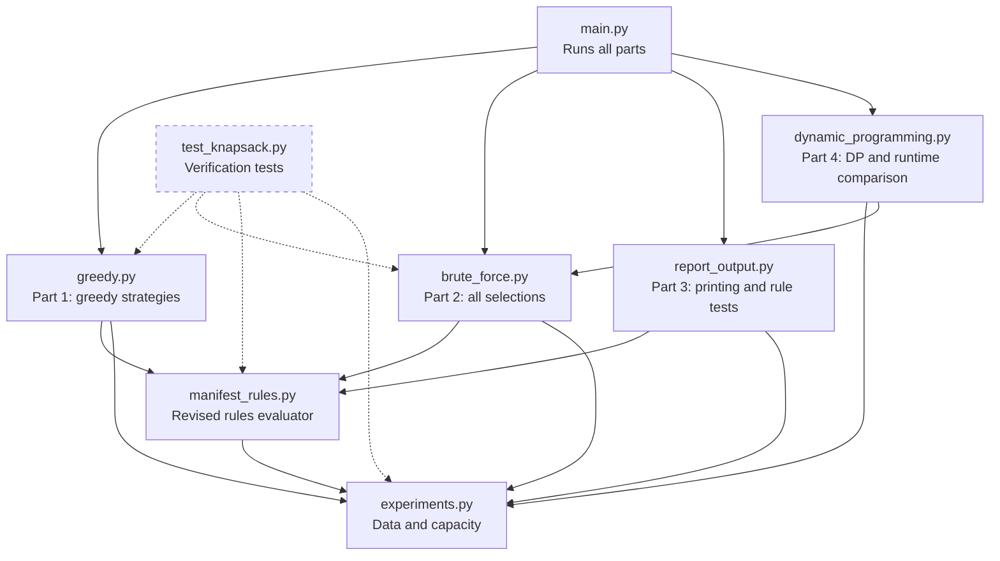

# Project Structure Diagram

Arrows mean "calls or uses". The dashed arrows come from the test file,
which imports the modules it checks. It does not import `main.py` or
`report_output.py`, and it is not part of the normal run.

## Module descriptions

- **main.py**: entry point. Runs the three greedy strategies (plus the retry variant), the brute-force search, the rule tests, the comparison summary, and the dynamic programming demo, in that order.
- **greedy.py**: three greedy strategies (highest rating, lightest, best ratio) built on one shared helper. It checks every tentative addition with the evaluator, and an optional retry pass lets Experiment 11a in after 11.
- **brute_force.py**: checks all 2^13 = 8192 selections with a bitmask, uses the evaluator to decide which are feasible, and returns the top three. Also holds the DP pseudocode comments.
- **manifest_rules.py**: the shared evaluator used by both the greedy and brute-force solutions. It enforces the three revised rules (solar instrument limit, thermal mass credit, 11a prerequisite) and checks adjusted mass against the capacity.
- **report_output.py**: formats each result, prints the matched / didn't-match comparison summary, and runs the rule-test table (expected vs. actual).
- **dynamic_programming.py**: the extra-credit DP table solution for the original 12-experiment problem, plus a runtime comparison that calls `brute_force_top3`.
- **experiments.py**: the original 12 experiments, the revised 13-experiment manifest with 11a, the 700 kg capacity, and the `ratio` and `totals` helpers.
- **test_knapsack.py**: verification tests and edge cases for the rules, greedy strategies, and brute-force results.